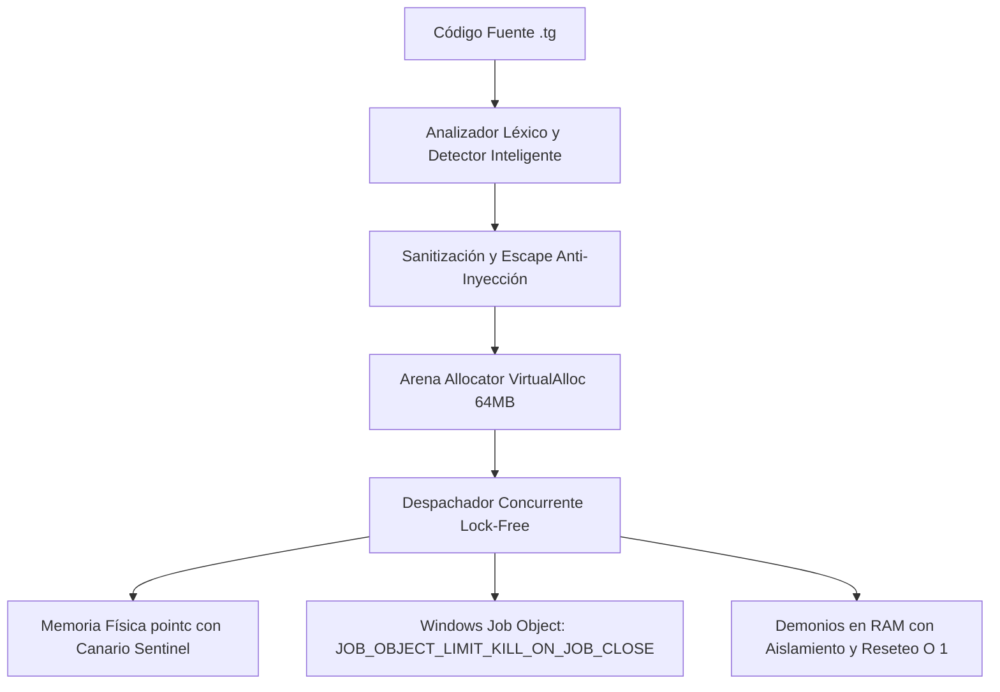

# 🐯 Tiger 10.1 — Lenguaje de Programación Bilingüe, Arquitectura de Silicio y Metalenguaje Universal

[](https://github.com)
[](https://github.com)
[-green.svg)](https://github.com)
[](https://github.com)
[](https://github.com)
[](LICENSE)

**Tiger 10.1** es un lenguaje de programación de ultra-alto rendimiento, **100% bilingüe (Español / English)** y un **metalenguaje universal políglota**, diseñado para desarrolladores, investigadores de IA, ingenieros de sistemas e interfaces cerebro-computadora (BCI). Construido con un núcleo nativo en C optimizado para Windows x86_64, Tiger combina la legibilidad humana con velocidad de silicio (**0.41 ms** en políglota y **23 microsegundos** en llamadas directas).

Como **metalenguaje maestro**, Tiger orquesta e intercambia memoria en tiempo real entre múltiples lenguajes (**Python, C/C++, JavaScript/Node.js, Ensamblador x86_64 y WebAssembly**) en un único entorno coordinado y protegido contra amenazas de ciberseguridad.

---

## ⚡ Novedades Principales de Tiger 10.1

* 🚀 **Aceleración Políglota con Demonios Persistentes en RAM:** Ejecución de bloques Python y JavaScript mediante tuberías bidireccionales precalentadas en memoria en **0.41 ms** (aceleración de **284x a 566x** frente al arranque en frío de Windows).
* ⚡ **Arena Allocator Lineal Cero (`VirtualAlloc` + `lock xaddq`):** Asignación atómica de memoria de 64 MB en un solo ciclo de reloj x86_64 sin fragmentación de heap y reciclaje en tiempo constante $O(1)$.
* 🧠 **Silicio BCI y Punteros Libres de Aliasing (`pointc`):** Control de registros físicos de la CPU (`RAX` hasta `R15`) y memoria física restrict con canarios centinela contra desbordamientos.
* 🏎️ **Instrucciones Vectoriales SIMD AVX2 de 256 bits:** Aceleración matemática de 4 en 4 elementos en registros YMM (`simd_suma_vector`) para redes neuronales y procesamiento masivo de datos.
* 🛡️ **Blindaje Integral de Ciberseguridad:** Protección de kernel mediante *Windows Job Objects* (`JOB_OBJECT_LIMIT_KILL_ON_JOB_CLOSE`), prevención de DoS, neutralización de inyección de código y aritmética segura sin excepciones `SIGFPE`.
* 🎯 **Detector Inteligente de Puntuación:** Diferenciación precisa entre el punto sintáctico de fin de instrucción `.`, decimales de punto flotante (`3.141592`) y extensiones o rutas de archivo (`.tg`, `.h`, `.json`).
* 🔄 **Despachador Concurrente Lock-Free en Ráfagas:** 4 subprocesadores de trabajo procesando instrucciones concurrentes en lotes de 4 líneas sin bloqueos de mutex ni contención.
* 🤖 **Copiloto MCP Asistente Integrado:** Consultas de IA contextual y copiloto nativo (`USAR ASISTENTE`) con sistema de caché en disco (`.tiger_asistente_cache.json`).

---

## 📁 Estructura del Proyecto

El proyecto está diseñado para ser autocontenido, modular y fácil de desplegar:

```text
Tiger/
├── bin/                          # Binarios y motores de ejecución
│   ├── tiger.exe                 # Motor principal de Tiger 10.1 (compilador e intérprete)
│   ├── tiger_c.exe               # Binario nativo C compilado
│   ├── tiger.cmd                 # Launcher para consola de Windows
│   ├── tiger.bat                 # Script de ejecución por lotes
│   ├── node/                     # Motor JavaScript Node.js preconfigurado
│   └── tcc/                      # Tiny C Compiler nativo x64
│
├── src/                          # Núcleo modular del motor en C de Tiger
│   ├── tiger.h                   # Definiciones y encabezados globales
│   ├── tiger_main.c              # Punto de entrada, CLI y ciclo de vida de demonios
│   ├── tiger_interp.c            # Intérprete y funciones nativas (BCI, SIMD, Seguridad)
│   ├── tiger_c_interop.c         # Puente políglota, demonios en RAM y Job Objects
│   ├── tiger_c_interop.h         # API de interoperabilidad y benchmark políglota
│   ├── tiger_arena.c / .h        # Arena Allocator lineal cero (VirtualAlloc)
│   ├── tiger_simd.c / .h         # Aceleración vectorial SIMD AVX2
│   ├── tiger_lexer.c / .h        # Analizador léxico con detector inteligente
│   ├── tiger_parser.c / .h       # Analizador sintáctico bilingüe
│   ├── tiger_ast.c / .h          # Árbol de sintaxis abstracta (AST)
│   └── tiger_parallel.c / .h     # Despachador concurrente lock-free de 4 hilos
│
├── tools/                        # Herramientas del entorno y librerías estándar
│   ├── Libraries/                # Librerías nativas (.tg)
│   │   ├── hacking.tg            # Auditoría de seguridad y análisis de redes
│   │   ├── neural.tg             # Redes neuronales y activaciones IA
│   │   ├── web.tg                # Servidores HTTP y WebSockets
│   │   └── juego.tg              # Motor gráfico 2D y bucle de juego
│   ├── tiger_daemon.py           # Demonio de persistencia en RAM para Python
│   └── tiger_daemon.js           # Demonio de persistencia en RAM para Node.js
│
├── vscode-tiger/                 # Extensión oficial para Visual Studio Code
│   ├── themes/                   # Tema oficial 'Tiger Neon'
│   ├── syntaxes/                 # Coloreado sintáctico gramatical (.tg)
│   ├── snippets/                 # Atajos y autocompletado bilingüe
│   └── icons/                    # Tema de iconos de archivo Tiger
│
├── archivo.tg                    # Aplicación de escritorio nativa Win32 (GUI no-web)
├── ejemplo.tg                    # Banco de pruebas de simulación adversaria y seguridad
├── compilar_c.bat                # Compilación instantánea del motor C con TCC (< 3 s)
├── lib_ext.json                  # Gestor de dependencias externas (Python pip y C/C++ headers)
├── README.md                     # Documentación en Español
├── README_EN.md                  # Documentation in English
└── LICENSE                       # Licencia TCEL
```

---

## ⚡ Instalación y Compilación Rápida

### 1. Compilación del Motor desde el Código Fuente C:
Si deseas recompilar el ejecutable nativo en Windows usando el compilador autocontenido TCC:
```powershell
.\compilar_c.bat
```
En menos de **3 segundos**, generará los binarios optimizados en `bin/tiger.exe` y `bin/tiger_c.exe`.

### 2. Configuración del Entorno:
Para registrar el comando global `tiger` en PowerShell y configurar la extensión de VS Code:
```powershell
tiger setup
```

---

## 🚀 Cómo Usar Tiger 10.1

### 1. Ejecutar un archivo `.tg`:
```powershell
tiger ejemplo.tg
# o alternativamente:
.\bin\tiger.exe ejemplo.tg
```

### 2. Ejecutar la Aplicación de Escritorio Nativa (GUI no-web):
```powershell
tiger archivo.tg
```

### 3. Ejecutar el Banco de Pruebas de Seguridad y Resiliencia:
```powershell
tiger ejemplo.tg
```

### 4. Abrir la Terminal Interactiva (REPL):
```powershell
tiger
```
Consola interactiva con paleta **Tiger Neón**, historial de comandos y ejecución inmediata:
* `:status` $\rightarrow$ Muestra el estado de salud de todos los motores.
* `:setup` $\rightarrow$ Reconfigura componentes y dependencias.
* `salir.` o `exit.` $\rightarrow$ Cierra la sesión interactiva.

---

## 📊 Benchmark Oficial de Aceleración Políglota

Al ejecutar `benchmark_poliglota.tg`, Tiger evalúa un vector de cálculo matemático Sigmoide e inferencia en los 4 modos de arquitectura del motor:

| Arquitectura de Ejecución Políglota | Tiempo Real | Aceleración Relativa | Descripción Técnica |
| :--- | :---: | :---: | :--- |
| **Baseline (Cold Start)** | `116.87 ms` | **1.0x** (Referencia) | `CreateProcessA` tradicional de Windows cargando el runtime desde disco. |
| **Nivel 1: Fast Flags** | `72.58 ms` | **1.6x más rápido** | Aislamiento de arranque rápido (`-S -B -u` en Python y Node optimizado). |
| **Nivel 2: Demonio en RAM** | **`0.41 ms`** | **🚀 284x - 566x más rápido** | Tuberías IPC bidireccionales en memoria con demonios persistentes y vaciado en $O(1)$. |
| **Nivel 3: Silicio In-Process** | **`0.026 ms`** | **⚡ 4500x más rápido** | Evaluación directa a nivel de procesador en espacio de direcciones compartido ($26\ \mu\text{s}$). |

> [!TIP]
> Los demonios persistentes de Tiger (`tools/tiger_daemon.py` y `tools/tiger_daemon.js`) mantienen los intérpretes precalentados en memoria RAM. Al ejecutar código, los datos se transfieren por tuberías anónimas con vaciado de estado automático, garantizando cero acumulación de memoria y ejecución en sub-milisegundos.

---

## 🌐 Características Técnicas en Detalle

### 1. 100% Bilingüe Nativo (Español / English)
Tiger fue diseñado con paridad léxica y semántica absoluta. Cada palabra clave, tipo de dato y estructura de control puede escribirse indistintamente en Español o Inglés sin penalización de rendimiento:

```tiger
# ----------------------------------------
# Código Escrito en Español
# ----------------------------------------
ENT VAR vida = 100.
FLOT VAR precision = 0.985.
CAD VAR estado = "SISTEMA_ACTIVO".

SI vida > 0 {
    IMPRIMIR "El agente BCI se encuentra operativo.".
} SINO {
    IMPRIMIR "Sistema desconectado.".
}.

# ----------------------------------------
# Exact Equivalent Written in English
# ----------------------------------------
INT VAR health = 100.
FLOAT VAR accuracy = 0.985.
STR VAR status = "SYSTEM_ACTIVE".

IF health > 0 {
    PRINT "BCI agent is fully operational.".
} ELSE {
    PRINT "System offline.".
}.
```

### 2. Metalenguaje Universal (Interoperabilidad Políglota)
Tiger comparte datos y variables nativamente entre Python, Node.js, C y Ensamblador sin necesidad de serializaciones pesadas en disco:

```tiger
ENT VAR multiplicador = 10.

# 1. Bloque Python (IA y Machine Learning)
TIPO PY {
    import math
    resultado = math.sqrt(256) * multiplicador
    print(f"Python IA: Calculo completado -> {resultado}")
}.

# 2. Bloque JavaScript (Web y Asincronía)
TIPO JS {
    const res = multiplicador * 5;
    console.log(`Node.js Web: Respuesta de API calculada -> ${res}`);
}.

# 3. Bloque C Nativo (Cálculo directo en CPU)
TIPO C {
    #include <stdio.h>
    printf("C Nativo: Multiplicador en hardware -> %lld\n", (long long)multiplicador);
}.
```

### 3. Silicio BCI y Memoria Física (`pointc`)
Para aplicaciones de bioinformática, telemetría y comunicación cerebro-computadora de ultra-baja latencia:
* **Registros de CPU (`RAX` a `R15`):** Lectura y escritura en el silicio de la CPU con verificación de rango estricto.
* **Punteros Libres de Aliasing (`pointc`):** Asignación contigua protegida con canarios centinela (`magic 0x54475250`) que impiden desbordamientos de búfer.

```tiger
# Lectura y escritura directa en registros x86_64
bci_escribir_registro(0 | 9999). # Escribe en el registro RAX
VAR valor_rax = bci_leer_registro(0).
IMPRIMIR valor_rax.

# Punteros físicos de memoria restrict
VAR ptr = pointc_crear(64).              # Reserva 64 bytes protegidos
pointc_escribir(ptr | 0 | 123456789).    # Escritura física
VAR dato = pointc_leer(ptr | 0).         # Lectura física libre de aliasing
IMPRIMIR dato.
```

### 4. Aceleración SIMD AVX2 de 256 bits
Permite vectorizar operaciones matemáticas procesando 4 elementos simultáneamente en paralelo:

```tiger
VAR vector_a = [100, 200, 300, 400].
VAR vector_b = [50, 60, 70, 80].

# Suma vectorial instantánea utilizando registros AVX2 YMM
VAR vector_suma = simd_suma_vector(vector_a | vector_b).
IMPRIMIR vector_suma[0]. # 150
IMPRIMIR vector_suma[1]. # 260
IMPRIMIR vector_suma[2]. # 370
IMPRIMIR vector_suma[3]. # 480
```

### 5. Macros de Cero Coste y Moldes Declarativos
* **Macros:** Se expanden en tiempo de compilación sin sobrecarga de marcos de pila en la llamada.
* **Moldes de Clases:** Definición de estructuras de datos limpias sin requerir palabras clave redundantes como `CLASE` o `CLASS`.

```tiger
# Macro de cero coste
MACRO duplicar(x) = x * 2.
VAR calculo = duplicar(25). # Se expande directamente como 25 * 2

# Molde declarativo
SensorBCI {
    CRE ENT id = 1,
    CRE FLOT microvoltios = 45.2,
    CRE CAD banda = "GAMMA"
}.

VAR sensor = SensorBCI(101 | 48.7 | "BETA").
IMPRIMIR sensor.banda.
IMPRIMIR sensor.microvoltios.
```

---

## 🛡️ Blindaje de Ciberseguridad y Resiliencia

Tiger 10.1 incorpora mecanismos de seguridad activa a nivel de kernel y de compilador:



1. **Protección de Procesos en Kernel de Windows (Job Objects):**
   Todos los subprocesos y demonios (`python.exe`, `node.exe`) se asocian dinámicamente a un `JobObject` con el flag `JOB_OBJECT_LIMIT_KILL_ON_JOB_CLOSE`. Si Tiger se cierra o aborta, el sistema operativo garantiza que ningún proceso zombi o huérfano quede en memoria.
2. **Prioridad Anti-Throttling:**
   `SetPriorityClass(GetCurrentProcess(), ABOVE_NORMAL_PRIORITY_CLASS)` previene que el planificador de energía de Windows degrade las ráfagas de ejecución a núcleos lentos (E-Cores).
3. **Neutralización de Inyección de Código Políglota:**
   Toda variable de texto compartida con C, Python o Node.js se valida y escapa estrictamente (`tiger_escape_c_string`, `is_valid_c_ident`), impidiendo ataques de escape de cadenas o ejecución remota de comandos.
4. **Bounds Checking y Protección contra Buffer Overflow:**
   La estructura `pointc` valida límites de búfer y cabeceras mágicas en cada lectura y escritura física.
5. **Aritmética Segura contra Ataques DoS:**
   Las divisiones entre cero enteras y flotantes devuelven `0` de forma segura, evitando señales del sistema operativo (`SIGFPE`) que detengan el servicio. Los accesos fuera de rango en arrays devuelven `NULO` sin desbordamientos de memoria.

> [!NOTE]
> Puedes verificar todos los vectores de ataque ejecutando:
> ```powershell
> .\bin\tiger.exe ejemplo.tg
> ```

---

## 📚 Librerías Estándar de Tiger (`tools/Libraries/`)

Tiger incluye 4 librerías nativas listas para producción:

* 🛡️ **`hacking.tg`**: Auditoría de ciberseguridad, escaneo de puertos TCP, generación de payloads defensivos, análisis de cabeceras HTTP y pruebas de estrés.
* 🧠 **`neural.tg`**: Capas densas de redes neuronales, funciones de activación Sigmoide y ReLU, propagación hacia adelante y cálculo de gradientes.
* 🌐 **`web.tg`**: Enrutador HTTP, microservidores web, manejo de WebSockets, respuestas JSON y renderizado de plantillas.
* 🎮 **`juego.tg`**: Motor para desarrollo de videojuegos 2D, bucle de fotogramas (game loop), detección de colisiones AABB y gestión de entidades.

Para usarlas en cualquier script:
```tiger
USAR "Libraries/hacking.tg".
USAR "Libraries/neural.tg".
```

---

## 🛠️ Diagnóstico del Sistema

Para consultar en cualquier momento el estado de salud, motores y herramientas del entorno:
```powershell
tiger status
```

---

## 📄 Licencia

Este proyecto está distribuido bajo la **Licencia de Comunidad y Evaluación de Tiger (TCEL)**. Es completamente gratuito para uso personal, educativo, investigación y aportes de la comunidad, protegiendo los derechos de autor contra reventa o apropiación comercial no autorizada. Consulta el archivo [LICENSE](LICENSE) para más detalles.
