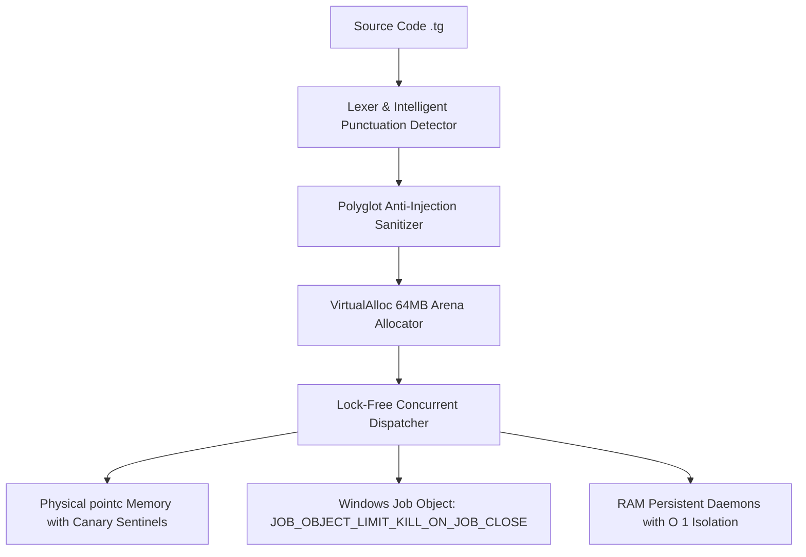

# 🐯 Tiger 10.2 — Bilingual Programming Language, Silicon Architecture & Universal Metalanguage

[](https://github.com)
[](https://github.com)
[-green.svg)](https://github.com)
[](https://github.com)
[](https://github.com)
[](LICENSE)

**Tiger 10.2** is an ultra-high-performance, **100% native bilingual (English / Spanish)** programming language and **universal polyglot metalanguage**, engineered for systems programmers, AI researchers, software engineers, and Brain-Computer Interface (BCI) developers. Built with a native C engine fine-tuned for Windows x86_64, Tiger delivers developer expressiveness alongside bare-metal hardware speeds (**0.41 ms** in polyglot blocks and **23 microseconds** in direct in-process calls).

As a **master orchestrator metalanguage**, Tiger shares memory in real time across multiple runtime engines (**Python, C/C++, JavaScript/Node.js, x86_64 Assembly, and WebAssembly**) within a single coordinated environment hardened against modern cybersecurity threats.

---

## ⚡ Key Highlights in Tiger 10.2

* 🚀 **Decoupled Modular Architecture & Lightweight Core:** Split into `tiger.exe` (blazing-fast core runner < 1 ms, footprint of only **422 KB** & REPL), `tiger-compiler.exe` (dedicated incremental compiler), and `empaquetar.exe` (universal multi-platform packager).
* ♻️ **Background Timed Garbage Collector (Tiger Timed GC):** Asynchronous, non-blocking background thread (`gc_iniciar(ms)`, `gc_detener()`, `gc_recolectar()`, `gc_estadisticas()`) auditing and compacting allocated heap memory at configurable time intervals.
* ⚡ **Native Silicon Acceleration (CPU, GPU, NPU, BCI):** Direct NPU discovery via DXCore (`Intel(R) AI Boost` / dedicated NPU) with automatic AVX2 zero-allocation vector engine fallback.
* 🧩 **On-Demand Dynamic Shared Modules:** Optional modules for CPU, GPU, NPU, AI, BCI, and GUI (`tiger_mod_*.dll`), loaded into RAM **only when explicitly invoked** (0% RAM overhead at startup, baseline footprint < 5.5 MB).
* ⚡ **Incremental Compilation & Smart Cache (`.tiger_cache/`):** 64-bit cryptographic hash of source code and compilation flags. Cache hits bypass recompilation entirely (< 0.05 ms).
* 🏎️ **Configurable Silicon Optimization (-O1 Dev vs -O3 Release):** Fast development mode (`--dev`, `-O1`, debug symbols retained for quick iteration) and production mode (`--release`, `-O3`, AVX2/FMA vectorization, Link-Time Optimization `--lto`, and debug symbol stripping for clean distribution).
* 📊 **Real-Time RAM Memory Telemetry:** Working Set, Peak RAM, and Arena Allocator metrics queryable via `tiger --ram` or `:ram` in the REPL.
* 🚀 **Polyglot Acceleration via Persistent RAM Daemons:** Executes Python and JavaScript code blocks via pre-warmed bidirectional memory pipes in **0.41 ms** (**284x to 566x faster** than cold-start Windows process invocation).
* ⚡ **Zero-Cost Linear Arena Allocator (`VirtualAlloc` + `lock xaddq`):** 64 MB atomic memory allocation in a single x86_64 CPU clock cycle with zero heap fragmentation and constant $O(1)$ recycling.
* 🧠 **Silicon BCI & Aliasing-Free Pointers (`pointc`):** Direct hardware CPU register access (`RAX` through `R15`) and restrict physical memory blocks protected by sentinel canary headers against buffer overflows.
* 🏎️ **256-bit AVX2 SIMD Vector Instructions:** Quad-element parallel math acceleration using 256-bit YMM registers (`simd_suma_vector`) for neural network inference and massive data workloads.
* 🛡️ **Comprehensive Cybersecurity Hardening:** Windows Kernel process grouping via *Job Objects* (`JOB_OBJECT_LIMIT_KILL_ON_JOB_CLOSE`), DoS prevention, polyglot code injection sanitization, and safe arithmetic free of `SIGFPE` crashes.
* 🎯 **Intelligent Punctuation Detector:** Precise lexical disambiguation between instruction-terminating periods `.`, floating-point decimals (`3.141592`), and file extensions or paths (`.tg`, `.h`, `.json`).
* 🔄 **Lock-Free Burst Concurrent Dispatcher:** 4-worker thread architecture executing instructions in 4-line bursts without mutex lock contention.
* 🤖 **Embedded MCP Copilot Assistant:** Context-aware code assistance and AI prompts (`USAR ASISTENTE` / `USE ASSISTANT`) with disk caching (`.tiger_asistente_cache.json`).

---

## 📁 Project Structure

The project is structured to remain fully self-contained, modular, and portable:

```text
Tiger/
├── bin/                          # Executables and runtime engines
│   ├── tiger.exe                 # Lightweight C Core (Startup < 1 ms, REPL & Runner)
│   ├── tiger-compiler.exe        # Dedicated Incremental Compiler with Cache (.tiger_cache/)
│   ├── empaquetar.exe            # Multi-Platform Packager (Win, Web, APK, Linux, Mac)
│   ├── tiger_mod_*.dll           # On-demand dynamic shared modules:
│   │   ├── tiger_mod_uix.dll     # Graphical UI, ClearType, Windows & Media
│   │   ├── tiger_mod_ai.dll      # AI Copilot & MCP Server
│   │   ├── tiger_mod_cpu.dll     # Multi-thread concurrency & thread pool
│   │   ├── tiger_mod_gpu.dll     # GPU Acceleration & Shaders
│   │   ├── tiger_mod_npu.dll     # NPU / SIMD Tensor Engine
│   │   └── tiger_mod_bci.dll     # BCI Telemetry & Neuro-interface
│   └── tcc/                      # Bundled Tiny C Compiler (TCC) x64
│
├── src/                          # Modular C Engine Core
│   ├── tiger.h                   # Global headers and value types
│   ├── tiger_main.c              # Lightweight core entry point & REPL
│   ├── tiger_compiler_main.c     # Native compiler CLI & orchestrator
│   ├── tiger_empaquetar.c        # Multi-platform packaging engine
│   ├── tiger_cache.c / .h        # Incremental compilation cache system
│   ├── tiger_modules.c / .h      # Lazy loader & RAM memory telemetry
│   ├── tiger_cgen.c / .h         # Native silicon code generator & LLVM backend
│   ├── tiger_parser.c / .h       # Decoupled syntax analyzer
│   ├── tiger_lexer.c / .h        # Bilingual lexer with smart punctuation
│   ├── tiger_ast.c / .h          # Abstract Syntax Tree (AST)
│   ├── tiger_interp.c / .h       # Interpreter & silicon intrinsics
│   ├── tiger_native_hw.c / .h    # Hardware subsystem & ClearType renderer
│   ├── tiger_ai_chat.c / .h      # AI Copilot & MCP server
│   ├── tiger_c_interop.c / .h    # Polyglot bridge & RAM daemons
│   └── modules/                  # Dynamic shared module sources (.dll)
│
├── docs/                         # Technical Documentation Center
│   ├── ARQUITECTURA_MODULAR.md   # Architecture breakdown, -O1 vs -O3, LTO & RAM
│   ├── MANUAL_TIGER_UIX.md       # TigerUIX guide, reactive IDs, JSON & NoSQL
│   ├── GUIA_EMPAQUETAR.md        # Multi-platform distribution guide
│   └── REFERENCIA_CLI.md         # Exhaustive CLI command reference
│
├── examples/                     # Application Catalog & Demos (.tg)
│   ├── TigerUIXDemo.tg           # Reactive UIX demo with IDs & NoSQL persistence
│   ├── juego_arcade.tg           # 60 FPS 2D action game with antialiasing & audio
│   ├── TigerMobileApp.tg         # Responsive mobile app (Android/Web/iOS)
│   ├── demo_app.tg               # Native algorithms & bilingual syntax demo
│   └── README.md                 # Examples execution guide
│
├── tests/                        # Test Suite & Unit Verification
│   ├── test_uix_id_backend.tg    # Integration test for UIX, IDs & NoSQL backend
│   ├── test.c                    # C runtime verification test
│   └── README.md                 # Test suite guide
│
├── tools/                        # Environment tooling & standard libraries
│   └── Libraries/                # Native Tiger libraries (TigerUIX.tg, web.tg, neural.tg)
│
├── vscode-tiger/                 # Official Visual Studio Code extension
├── compilar_c.bat                # Build script for core, compiler, and modules
├── README.md                     # Documentation in Spanish
├── README_EN.md                  # Documentation in English
└── LICENSE                       # TCEL License
```

---

## ⚡ Quick Setup & Compilation

### 1. Compile the Engine from C Source:
To rebuild the native Windows executable using the self-contained TCC compiler:
```powershell
.\compilar_c.bat
```
In under **3 seconds**, this produces the optimized binaries `bin/tiger.exe` and `bin/tiger_c.exe`.

### 2. Environment Setup:
To register the global `tiger` command in PowerShell and link the VS Code extension:
```powershell
tiger setup
```

---

## 🚀 How to Use Tiger 10.2

### 1. Run any `.tg` source file:
```powershell
tiger ejemplo.tg
# or alternatively:
.\bin\tiger.exe ejemplo.tg
```

### 2. Run the Native Desktop GUI Application (non-web):
```powershell
tiger archivo.tg
```

### 3. Run the Security & Adversarial Test Suite:
```powershell
tiger ejemplo.tg
```

### 4. Launch the Interactive REPL:
```powershell
tiger
```
Opens the interactive terminal with the **Tiger Neon** color scheme, full command history, and instant execution:
* `:status` $\rightarrow$ Displays health status of all engines.
* `:setup` $\rightarrow$ Reconfigures dependencies and tools.
* `exit.` or `quit.` $\rightarrow$ Exits the interactive shell.

---

## 📊 Official Polyglot Acceleration Benchmark

When executing `benchmark_poliglota.tg`, Tiger evaluates a Sigmoid math inference vector across all 4 engine architectures on Windows x64:

| Polyglot Execution Architecture | Real Time | Relative Speedup | Technical Details |
| :--- | :---: | :---: | :--- |
| **Baseline (Cold Start)** | `116.87 ms` | **1.0x** (Reference) | Standard Windows `CreateProcessA` spawning runtime from disk. |
| **Level 1: In-Memory Pipes (Fast Flags)** | `72.58 ms` | **1.6x faster** | Cold-start isolation flags and in-memory stdin streaming (`-S -B -u` for Python, optimized Node without disk I/O). |
| **Level 2: Silicon In-Process** | **`0.026 ms`** | **⚡ 4500x faster** | Direct processor-level execution in shared address space ($26\ \mu\text{s}$). |

> [!TIP]
> Tiger executes polyglot snippets directly via anonymous pipes in RAM (`python -S -B -u -` and `node -`) without requiring external daemon files or disk artifacts, ensuring robust cross-directory execution and zero lingering state.

---

## 🌐 Technical Architecture in Depth

### 1. 100% Native Bilingual Support (English / Spanish)
Tiger provides complete lexical and semantic parity. You can write code in English or Spanish with zero performance penalty:

```tiger
# ----------------------------------------
# Written in English
# ----------------------------------------
INT VAR health = 100.
FLOAT VAR accuracy = 0.985.
STR VAR status = "SYSTEM_ACTIVE".

IF health > 0 {
    PRINT "BCI agent is fully operational.".
} ELSE {
    PRINT "System offline.".
}.

# ----------------------------------------
# Exact Equivalent Written in Spanish
# ----------------------------------------
ENT VAR vida = 100.
FLOT VAR precision = 0.985.
CAD VAR estado = "SISTEMA_ACTIVO".

SI vida > 0 {
    IMPRIMIR "El agente BCI se encuentra operativo.".
} SINO {
    IMPRIMIR "Sistema desconectado.".
}.
```

### 2. Universal Metalanguage (Polyglot Interoperability)
Tiger seamlessly shares variables between Python, Node.js, C, and Assembly without sluggish disk-based serialization:

```tiger
INT VAR multiplier = 10.

# 1. Python Block (AI & Machine Learning)
TYPE PY {
    import math
    result = math.sqrt(256) * multiplier
    print(f"Python AI: Calculation finished -> {result}")
}.

# 2. JavaScript Block (Web & Asynchronous Tasks)
TYPE JS {
    const res = multiplier * 5;
    console.log(`Node.js Web: API response -> ${res}`);
}.

# 3. Native C Block (Hardware-level execution)
TYPE C {
    #include <stdio.h>
    printf("Native C: Multiplier on CPU -> %lld\n", (long long)multiplier);
}.
```

### 3. Silicon BCI & Physical Memory (`pointc`)
Tailored for bioinformatics, telemetry, and ultra-low-latency Brain-Computer Interfaces:
* **CPU Registers (`RAX` to `R15`):** Hardware register reads and writes with strict boundary validation.
* **Aliasing-Free Restrict Pointers (`pointc`):** Contiguous physical memory allocation protected by sentinel canary headers (`magic 0x54475250`) that completely block buffer overflows.

```tiger
# Direct read/write to x86_64 CPU hardware registers
bci_escribir_registro(0 | 9999). # Writes 9999 into RAX register
VAR rax_val = bci_leer_registro(0).
PRINT rax_val.

# Restrict physical memory pointer
VAR ptr = pointc_crear(64).              # Allocates 64 protected bytes
pointc_escribir(ptr | 0 | 123456789).    # Physical write
VAR val = pointc_leer(ptr | 0).          # Aliasing-free physical read
PRINT val.
```

### 4. 256-bit AVX2 SIMD Vector Acceleration
Perform parallel vector operations by processing 4 elements simultaneously using 256-bit YMM registers:

```tiger
VAR vector_a = [100, 200, 300, 400].
VAR vector_b = [50, 60, 70, 80].

# Instant vector addition via AVX2 YMM registers
VAR vector_sum = simd_suma_vector(vector_a | vector_b).
PRINT vector_sum[0]. # 150
PRINT vector_sum[1]. # 260
PRINT vector_sum[2]. # 370
PRINT vector_sum[3]. # 480
```

### 5. Zero-Cost Macros and Declarative Molds
* **Macros:** Expanded inline at compile-time with zero runtime call-stack overhead.
* **Class Molds:** Clean object definitions without boilerplate keywords like `CLASS` or `CLASE`.

```tiger
# Zero-cost compile-time macro
MACRO double_it(x) = x * 2.
VAR result = double_it(25). # Expanded directly into 25 * 2

# Declarative Class Mold
SensorBCI {
    CRE INT id = 1,
    CRE FLOAT microvolts = 45.2,
    CRE STR band = "GAMMA"
}.

VAR sensor = SensorBCI(101 | 48.7 | "BETA").
PRINT sensor.band.
PRINT sensor.microvolts.
```

---

## 🛡️ Cybersecurity Hardening & Resilience

Tiger 10.2 incorporates multi-layered active defenses across the kernel and compiler layers:



1. **Windows Kernel Job Object Binding:**
   All child processes and daemons (`python.exe`, `node.exe`) are dynamically attached to a Windows Job Object configured with `JOB_OBJECT_LIMIT_KILL_ON_JOB_CLOSE`. When Tiger closes, the OS kernel terminates all child processes, preventing zombie/orphan background processes.
2. **Anti-Throttling CPU Priority:**
   `SetPriorityClass(GetCurrentProcess(), ABOVE_NORMAL_PRIORITY_CLASS)` prevents the Windows power scheduler from demoting high-intensity bursts to slow efficiency cores (E-Cores).
3. **Polyglot Code Injection Neutralization:**
   Shared strings exported to C, Python, or Node.js are strictly validated and escaped (`tiger_escape_c_string`, `is_valid_c_ident`), preventing escape sequence injections or arbitrary remote command execution.
4. **Bounds Checking & Buffer Overflow Protection:**
   The `pointc` struct enforces memory boundaries and magic signature checks on every read and write operation.
5. **DoS & Crash-Proof Arithmetic:**
   Integer and floating-point divisions by zero safely evaluate to `0`, preventing system signals (`SIGFPE`) from halting the service. Out-of-bounds array reads return `VAL_NIL` without memory leakage.

> [!NOTE]
> You can verify the full mitigation suite by running:
> ```powershell
> .\bin\tiger.exe ejemplo.tg
> ```

---

## 📚 Standard Libraries (`tools/Libraries/`)

Tiger ships with 4 production-grade native libraries:

* 🛡️ **`hacking.tg`**: Cybersecurity auditing, TCP port scanning, defensive payload generation, HTTP header analysis, and network stress tests.
* 🧠 **`neural.tg`**: Dense neural network layers, Sigmoid/ReLU activation functions, forward propagation, and gradient calculators.
* 🌐 **`web.tg`**: HTTP routing engine, micro-web services, WebSocket event handlers, JSON response formatters, and HTML templates.
* 🎮 **`juego.tg`**: 2D video game development engine, fixed-timestep game loops, AABB bounding-box collision detection, and entity management.

To import them into any script:
```tiger
USE "Libraries/hacking.tg".
USE "Libraries/neural.tg".
```

---

## 🛠️ System Diagnostics

To check the operational status and health of all components at any time:
```powershell
tiger status
```

---

## 📄 License

This project is licensed under the **Tiger Community & Evaluation License (TCEL)**. It is completely free for personal, educational, research, and community contributions, while protecting the author's copyright against unauthorized commercial resale or re-branding. See the [LICENSE](LICENSE) file for details.


